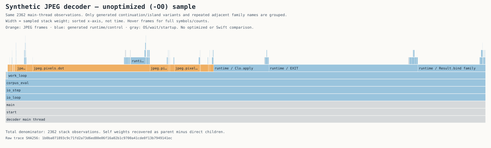

# Synthetic JPEG diagnostic

The sampled unoptimized (`-O0`) macOS child spent substantial time in the JPEG pixel transform and generated Bend runtime. Of **2,362 main-thread samples**, `jpeg.pixels.dot` and its continuations account for 448 exclusive samples (18.97%); `unpack` has 119 (5.04%) and `pass_walk` 82 (3.47%). Generated `EXIT`, `Result.bind` and `Clo.apply` together have 1,246 exclusive samples (52.75%). Those generic runtime samples cannot all be assigned to IDCT.

Width represents weighted stack observations, not time order. The conversion preserves the printed call-tree weights and reconciles the independent top-of-stack table. The waiting helper thread is excluded. This is one sampled window in Tart, **not complete decode time, function-call counts, exact CPU milliseconds, optimized latency or a Swift comparison**. The build receipt establishes `-O0`; the sample header does not.

A separate same-host Linux fixture run compared the original dense transform with a Bend DC-only fast path:

| Variant | Monitored fixture wall time | Result |
| --- | ---: | --- |
| Original | 44.833 s | 52 checks passed |
| DC-only fast path | 5.840 s | 52 checks passed |

Both used Clang 22.1.8 `-O0`, Bend 2.0.37 and Bun 1.4.2. Only `src/jpeg/pixels.bend` differed. Each ran once, baseline first, without warmup or cache reset. The 1024 × 640 synthetic JPEG uses only DC coefficients. The oracle verifies its input hash, geometry, 24 selected pixels and progressive refusal; it does not compare every raster pixel. The measured process includes these checks. **These numbers do not establish arbitrary-JPEG, optimized, macOS or UI performance.**

[Machine-readable evidence](jpeg-diagnostic.json) contains source and raw-receipt hashes. Absolute paths, machine names, process identifiers, raw traces and reference source are excluded. This receipt makes no native UI acceptance claim.
